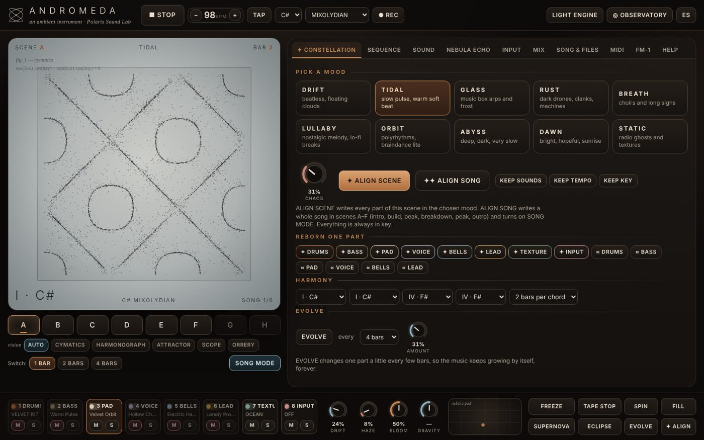

<h1 align="center">A N D R O M E D A</h1>
<p align="center"><i>an ambient instrument · un instrumento ambient</i><br>
Dark Funk Durcal design · Created at <b>Polaris Sound Lab</b>, Mérida, Yucatán, México<br>
<a href="https://www.instagram.com/polaris.sound.lab/">Instagram @polaris.sound.lab</a> · <a href="https://www.youtube.com/@PolarisSoundLab">YouTube @PolarisSoundLab</a></p>

<p align="center">
<a href="https://drophlex.github.io/ANDROMEDA/"><b>▶ Play it in your browser</b></a> &nbsp;·&nbsp;
<a href="https://drophlex.github.io/ANDROMEDA/guide/"><b>✦ Quick guide</b></a> &nbsp;·&nbsp;
<a href="https://github.com/drophlex/ANDROMEDA/releases/latest/download/ANDROMEDA-mac.zip"><b>⤓ Mac app · VST3 · AU</b></a> &nbsp;·&nbsp;
<a href="https://github.com/drophlex/ANDROMEDAFM1"><b>🎛 FM-1 firmware</b></a> &nbsp;·&nbsp;
<a href="https://www.paypal.com/donate/?business=drophlex%40gmail.com&no_recurring=0&item_name=ANDROMEDA&currency_code=USD"><b>♥ Donate</b></a>
</p>

<p align="center"></p>

**Free and open source** (AGPL-3.0). The program is in **English**; the **EN · ES** button (top right) switches the web, the Mac app and the plug-in to **Spanish**. On the FM-1: VISION page › K4 (LANG). Manuals in English and Spanish.

## ⚡ Quick guide

1. **Open it** — [drophlex.github.io/ANDROMEDA](https://drophlex.github.io/ANDROMEDA/) in Chrome, press **ENTER**. (Mac app / Ableton: install below.)
2. **Choose a mood** in ✦ PLAY (DRIFT, TIDAL, GLASS…) and press **ALIGN SONG**: a whole piece appears, always in key.
3. **▶ PLAY**, then turn on **✦ AUTO**: the music keeps growing from your pattern, by itself.
4. **Shape the sky** with DRIFT · HAZE · BLOOM · GRAVITY, play the SPACE TAPE and the FX pad.
5. **Play over it** on a MIDI keyboard or the computer keys Z–M; **● REC** records a WAV, SONG & FILES saves your piece.

### Install on Mac (app + VST3 + AU)

Open **Terminal** (Applications › Utilities), paste this line, press Return. It installs everything and unblocks it for macOS:

```
curl -fsSL https://drophlex.github.io/ANDROMEDA/install.sh | bash
```

Or download [ANDROMEDA-mac.zip](https://github.com/drophlex/ANDROMEDA/releases/latest/download/ANDROMEDA-mac.zip) and right-click **Install ANDROMEDA.command › Open**.
**Ableton Live:** Settings › Plug-Ins › turn on *VST3 Plug-In System Folders* › Rescan, then drag **ANDROMEDA** onto a MIDI track.

### 📖 Manuals (PDF)

Illustrated, one for each edition:

| Edition | English | Español | Both |
|---|---|---|---|
| 🎛 **Plug-in** (VST3 · AU · Mac app, Ableton Live) | [EN](manual/ANDROMEDA-VST-Manual-EN.pdf) | [ES](manual/ANDROMEDA-VST-Manual-ES.pdf) | [EN + ES](manual/ANDROMEDA-VST-Manual-EN-ES.pdf) |
| 🌐 **Web** | [EN](manual/ANDROMEDA-Web-Manual-EN.pdf) | [ES](manual/ANDROMEDA-Web-Manual-ES.pdf) | [EN + ES](manual/ANDROMEDA-Web-Manual-EN-ES.pdf) |
| 🪐 **M-VAVE FM-1** firmware | [EN](manual/ANDROMEDA-FM1-Manual-EN.pdf) | [ES](manual/ANDROMEDA-FM1-Manual-ES.pdf) | [EN + ES](manual/ANDROMEDA-FM1-Manual-EN-ES.pdf) |
| Web · Mac · Ableton together | [EN](manual/ANDROMEDA-Manual-EN.pdf) | [ES](manual/ANDROMEDA-Manual-ES.pdf) | [EN + ES](manual/ANDROMEDA-Manual-EN-ES.pdf) |
| Complete (with the FM-1) | | [ES](manual/ANDROMEDA-Manual-Completo-ES.pdf) | [EN + ES](manual/ANDROMEDA-Manual-Completo-EN-ES.pdf) |

---

## English — what it is

Warm, drifting, nostalgic ambient music: breathing pulse-width pads, choirs, music boxes, FM bells, bowed metal, lo-fi drum machines, dust and wind. **Everything is always in key.**

- **Draw a pattern, then turn on ✦ AUTO**: ANDROMEDA keeps writing from *your* pattern (your intervals, your rhythms), always in key and in time, with parts fading in and out by ENERGY.
- **Play over it on any keyboard.** KEYS = SHIFT: a note outside the scale glides the music to the nearest scale on the next beat; what you play becomes a motif the music answers.
- **13 moods**, 53 sounds, 7 drum kits, 7 textures, scenes A–H, song mode.
- **Space Tape**: three-head tape echo with the 12-position mode selector, repeat rate, intensity, bass, treble, input level with peak light, wow, flutter, tape age, spring reverb (kick it!), freeze, spin, tempo sync.
- **16 FX & filters** that enter on the beat and leave with a fade: ladder, acid, MS, high sweep, band, vowel, envelope, notch, phaser, jet, ensemble, repeat, dust, half-speed, gate, metal. XY pad.
- **Audio in**: mic, line, an audio file or (in the plug-in) a sidechain, through its own filter, the tape and the Cosmos reverb.
- Every change is smooth: scenes on the bar, mutes with fades, effects on the 1/16.
- MIDI in, pads, MIDI learn, export **.mid**, record **WAV**, save **.andromeda** (same file in web and plug-in).

### Mac plug-in
Download the zip above, unzip, right-click **Install ANDROMEDA.command → Open**. In Ableton: Settings → Plug-ins → VST3 system folders on → Rescan. It follows Live's tempo; 74 parameters in banks of 8 appear on any controller screen. Arturia KeyLab Essential 49 guide: [installer/KeyLab-Essential-49.md](installer/KeyLab-Essential-49.md).

---

## Español — qué es

Música ambient cálida, flotante y nostálgica. **Todo suena siempre en tono.**

- **Dibuja un patrón y enciende ✦ AUTO**: ANDROMEDA sigue escribiendo a partir de *tu* patrón (tus intervalos, tus ritmos), siempre en tono y en tiempo; las partes entran y salen con fundido según la ENERGÍA.
- **Toca encima con cualquier teclado.** TECLAS = MODULAR: una nota fuera de la escala lleva la música a la escala más cercana en el siguiente tiempo, y lo que tocas se vuelve un motivo al que la música contesta.
- **13 estados**, 53 sonidos, 7 kits, 7 texturas, escenas A–H, modo canción.
- **Space Tape**: eco de cinta de tres cabezas con el selector de 12 modos, velocidad, intensidad, graves, agudos, volumen de entrada con luz de pico, wow, flutter, desgaste, resorte (¡golpéalo!), congelar, girar y sincronía.
- **16 efectos y filtros** que entran a tiempo y salen con fundido. Pad XY.
- **Entrada de audio**: micrófono, línea, un archivo o (en el plug-in) sidechain.
- Todo cambia suave: escenas al compás, silencios con fundido, efectos al 1/16.

### Plug-in para Mac
Descarga el zip, descomprímelo, clic derecho en **Install ANDROMEDA.command → Abrir**. En Ableton: Ajustes → Plug-ins → carpetas de sistema VST3 → Volver a escanear. Guía del KeyLab Essential 49: [installer/KeyLab-Essential-49.md](installer/KeyLab-Essential-49.md).

---

`engine/` C++ engine (same code in web as WebAssembly and in the plug-in) · `ui/` interface · `plugin/` JUCE wrapper · `tools/build_web.py` builds the web page.


---

## Open source · Código abierto

ANDROMEDA is free: play it, read it, change it, share it under the **GNU AGPL-3.0** ([LICENSE](LICENSE)); the plug-in is built with JUCE (AGPL-3.0). The FM-1 firmware is GPL-3.0 ([drophlex/ANDROMEDAFM1](https://github.com/drophlex/ANDROMEDAFM1)).
ANDROMEDA es gratis: tócalo, léelo, cámbialo y compártelo bajo la **GNU AGPL-3.0**.

Build: `python3 tools/build_web.py` (web, needs clang + wasm-ld) · `plugin/` with CMake (JUCE 8 is fetched) · CI in `.github/workflows/build.yml` tests the plug-in with pluginval and auval.

If ANDROMEDA brings you good moments / si ANDROMEDA te regala buenos momentos: **[♥ Donate with PayPal · Dona con PayPal](https://www.paypal.com/donate/?business=drophlex%40gmail.com&no_recurring=0&item_name=ANDROMEDA&currency_code=USD)**
