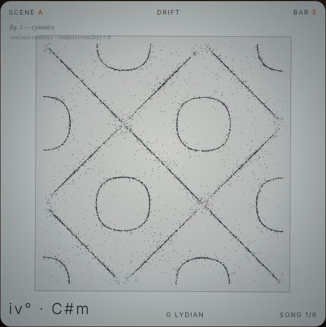
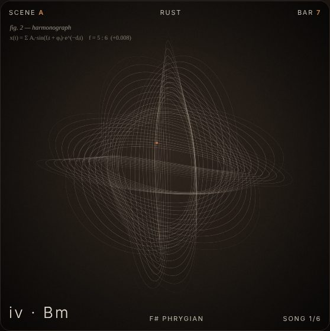
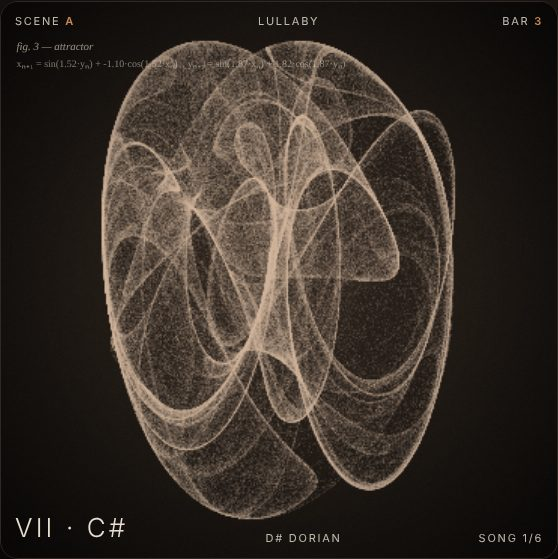
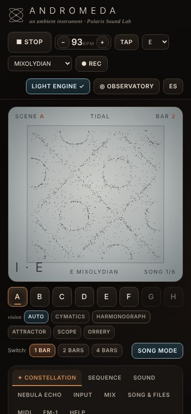

# ANDROMEDA

**An ambient instrument that lives in your browser.**
*Un instrumento ambient que vive en tu navegador.*

▶ **Try it / Pruébalo:** https://drophlex.github.io/ANDROMEDA/

> 🧪 **Beta preview.** Still in progress: feedback is very welcome.
> **Versión beta.** Todavía en desarrollo: tus comentarios son bienvenidos.

---

## English

ANDROMEDA makes warm, drifting, nostalgic ambient music: pads that breathe like old tape, choirs, music boxes, lo-fi drum machines, dust and wind. You don't need music theory, because **everything is always in key**.

### What it does
- **10 moods**: DRIFT, TIDAL, GLASS, RUST, BREATH, LULLABY, ORBIT, ABYSS, DAWN, STATIC. Press **✦✦ ALIGN SONG** and it writes a whole song (intro, build, peak, breakdown, outro).
- **8 tracks**: drums, bass, pad, voice, bells, lead, texture and your own **audio input**.
- **Nebula Echo**: a three-head tape echo with 12 modes, spring reverb, wow & flutter, tape age, FREEZE and SPIN, and you can watch the tape run.
- **Mathematical visuals that listen**: Chladni cymatics, a harmonograph drawn with the ratios of each chord, a Clifford strange attractor, a stereo scope, and an orrery.
- **Live tools**: scenes A–H, song mode, the DRIFT / HAZE / BLOOM / GRAVITY macros, the nebula pad, TAPE STOP, SUPERNOVA, ECLIPSE, FILL, and EVOLVE (the music keeps changing by itself, forever).
- **Input + looper**: run your mic, guitar or synth through the echo and the reverb, and loop it in time.
- **MIDI** in and out, clock, MIDI learn, export to **.mid** and record to **WAV**.
- Works offline, in English and Spanish, and saves your project automatically.

### Quick start
1. Open the link and press **ENTER**: it starts playing.
2. Choose a mood, press **✦✦ ALIGN SONG**.
3. Move the macros, hold the **nebula pad**, try **FREEZE** and **SUPERNOVA**.
4. Play the selected track with your keyboard: `Z S X D C V G B H N J M , L . ; /` (always in key).

**Best in Chrome or Edge.** Safari works too (no MIDI there). On phones, the **LIGHT ENGINE** turns on by itself so the sound never breaks up. Headphones recommended.

---

## Español

ANDROMEDA hace música ambient cálida, flotante y nostálgica: pads que respiran como cinta vieja, coros, cajas de música, cajas de ritmo lo-fi, polvo y viento. No necesitas saber teoría musical, porque **todo suena siempre en tono**.

### Qué hace
- **10 estados de ánimo** (DRIFT, TIDAL, GLASS, RUST, BREATH, LULLABY, ORBIT, ABYSS, DAWN, STATIC). Con **✦✦ ALIGN SONG** escribe una canción completa (intro, subida, clímax, pausa, final).
- **8 pistas**: batería, bajo, pad, coro, campanas, lead, textura y tu propia **entrada de audio**.
- **Nebula Echo**: eco de cinta de tres cabezas con 12 modos, resorte, wow y flutter, desgaste de cinta, CONGELAR y GIRAR, y ves la cinta correr.
- **Visuales matemáticos que escuchan**: cimática de Chladni, harmonógrafo con las proporciones de cada acorde, atractor de Clifford, osciloscopio estéreo y una carta astral.
- **Para tocar en vivo**: escenas A–H, modo canción, las macros DERIVA / BRUMA / FLORECER / GRAVEDAD, el nebula pad, TAPE STOP, SUPERNOVA, ECLIPSE, FILL y EVOLVE (la música sigue cambiando sola).
- **Entrada + looper**: pasa tu micrófono, guitarra o sinte por el eco y la reverb, y haz loops en tiempo.
- **MIDI** de entrada y salida, reloj, MIDI learn, exportar a **.mid** y grabar en **WAV**.
- Funciona sin internet, en inglés y español, y guarda tu proyecto solo.

### Empezar
1. Abre el link y presiona **ENTER** (en español, **ENTRAR**): empieza a sonar.
2. Elige un estado y presiona **✦✦ ALIGN SONG**.
3. Mueve las macros, mantén el **nebula pad**, prueba **FREEZE** y **SUPERNOVA**.
4. Toca la pista seleccionada con el teclado: `Z S X D C V G B H N J M , L . ; /` (siempre en tono).

**Mejor en Chrome o Edge.** También abre en Safari (ahí no hay MIDI). En celulares se activa solo el **LIGHT ENGINE** para que el sonido no se corte. Se recomienda usar audífonos.

---

| | |
|---|---|
|  |  |
|  |  |

---

**Created at Polaris Sound Lab** · Mérida, Yucatán, México
[Instagram @polaris.sound.lab](https://www.instagram.com/polaris.sound.lab/) · [YouTube @PolarisSoundLab](https://www.youtube.com/@PolarisSoundLab)

Coming next: an ANDROMEDA firmware for the M-VAVE FM-1 and a VST3/AU plugin.
*Próximamente: firmware de ANDROMEDA para el M-VAVE FM-1 y plugin VST3/AU.*

© 2026 Polaris Sound Lab. All rights reserved.
